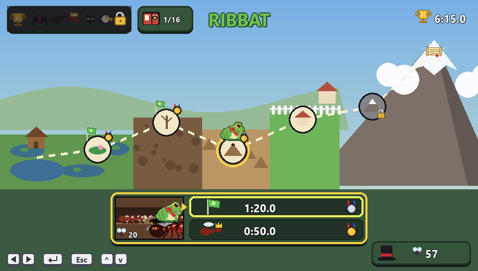
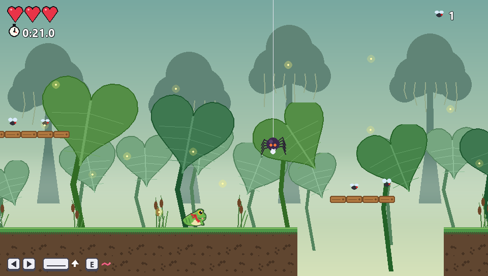
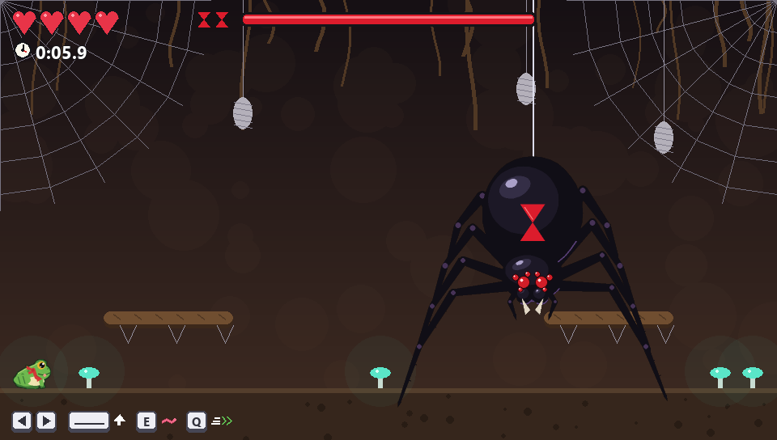
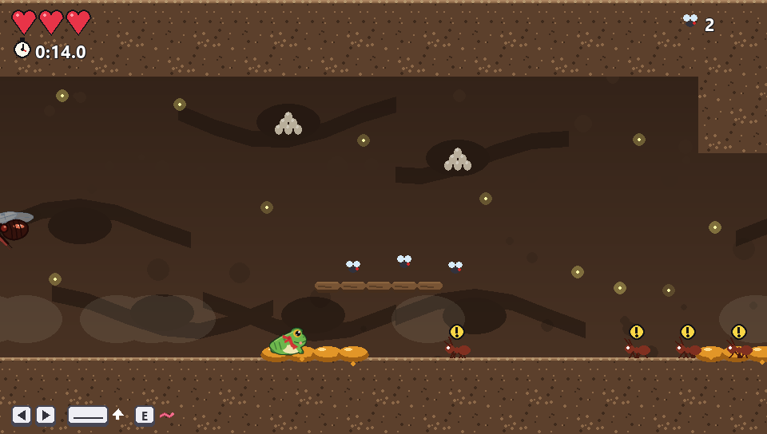
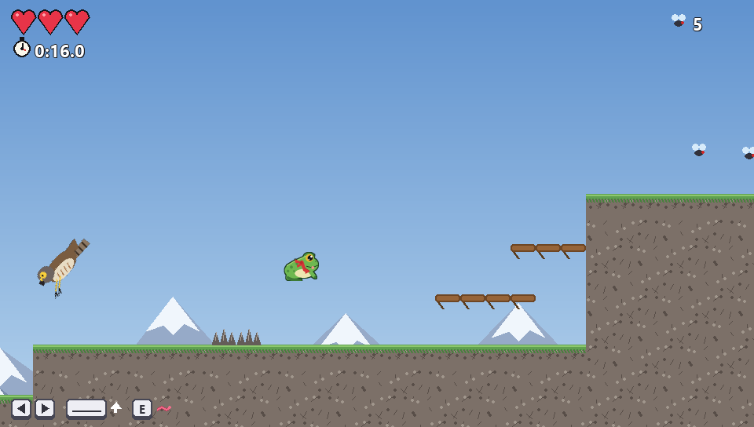
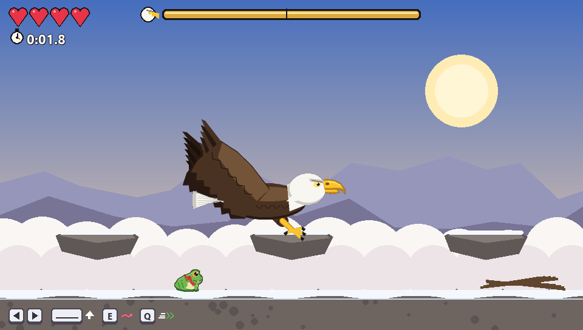

<p align="center"></p>

<h1 align="center">Ribbat e o Pergaminho Perdido</h1>

<p align="center">Um jogo de plataforma sobre um sapinho que atravessa o mundo atrás do pergaminho que o vô dele contou.</p>

<p align="center"><b><a href="https://github.com/ielgomesjf-web/Ribbat/releases/latest">⬇️ Baixar o jogo (Windows)</a></b></p>



## A história

O vô do Ribbat conta, numa noite na beira da lagoa, sobre um **pergaminho perdido** lá no topo da montanha. O Ribbat
decide ir atrás dele. O caminho passa pelo pântano, pelo lamaçal, pelo formigueiro, pelo quintal de uma casa e pela
montanha, e em cada lugar tem um **chefão** esperando no fim.

A história é contada em **quadrinhos sem texto**.

## Como baixar e jogar

1. Entre em **[Releases](https://github.com/ielgomesjf-web/Ribbat/releases/latest)** e baixe um dos dois:
   - **`Instalar-Ribbat.exe`**: instala o jogo, cria atalho na Área de Trabalho e no menu Iniciar, e aparece em
     "Aplicativos instalados" pra desinstalar.
   - **`Ribbat.exe`**: o jogo direto, sem instalar. É só abrir e jogar.
2. Na primeira vez, o Windows pode mostrar **"O Windows protegeu o computador"**. Isso acontece com qualquer jogo
   feito em casa (o arquivo não tem assinatura digital paga). Clique em **"Mais informações"** e depois em
   **"Executar assim mesmo"**.

Funciona no Windows 10 e 11. Não precisa de internet.

## Controles

| Tecla | O que faz |
|---|---|
| ← → ou A D | andar |
| Espaço, W ou ↑ | pular (segurando, pula mais alto) |
| E | linguada |
| Q | investida |
| G | liga/desliga o sapo fantasma |
| Esc | pausa |
| F11 | tela cheia |

A linguada e a investida são liberadas pelas bandeiras ao longo de cada fase. A 3ª bandeira dá um coração a mais.

## O que tem no jogo

- **5 fases**: o Pântano, o Lamaçal, o Formigueiro, o Quintal e a Montanha.
- **5 chefões** no estilo Cuphead: a Viúva Negra, o Besouro-rinoceronte, a Formiga Rainha, o Gato e a Águia-careca.
  Todo ataque tem aviso, então dá pra vencer só prestando atenção.
- **Uma corrida final** contra a Águia até o pergaminho.
- **Relógio e recordes** em cada fase e chefão, com medalhas de bronze, prata e ouro, e um coração pra quem zera
  sem levar dano.
- **Sapo fantasma**: ele refaz o teu melhor tempo, pra tu correr contra ele.
- **Maratona de chefões**: os 5 seguidos, num relógio só.
- **Loja de chapéus**: as moscas que tu junta viram dinheiro.
- **Álbum** com 16 figurinhas pra colecionar.
- Músicas e efeitos sonoros feitos pelo próprio código.
- E um **segredo** pra quem zerar o jogo. 🤫

| | |
|---|---|
|  |  |
|  |  |



## Créditos

Criado por **Gomes**: a história, as fases, os chefões e as músicas (compostas no [Strudel](https://strudel.cc)).
Programado com a ajuda do Claude (IA).

---

### Pra quem quer mexer no código

O jogo é feito em **Python** com **Pygame**. Todos os desenhos, músicas e sons são gerados pelo código, então o jogo
não usa nenhum arquivo de imagem ou áudio.

```
pip install pygame
python ribbat.py
```

- `python teste.py` roda os testes automáticos. Robôs jogam todas as fases e lutam com todos os chefões, e no fim
  aparece **TUDO CERTO!**. Os testes usam um save separado.
- `gerar_exe.bat` gera o `dist\Ribbat.exe` (precisa do `pyinstaller`).
- `gerar_instalador.bat` gera o `dist\Instalar Ribbat.exe` (rode o `gerar_exe.bat` antes).

O save fica em `%APPDATA%\Ribbat\`.
